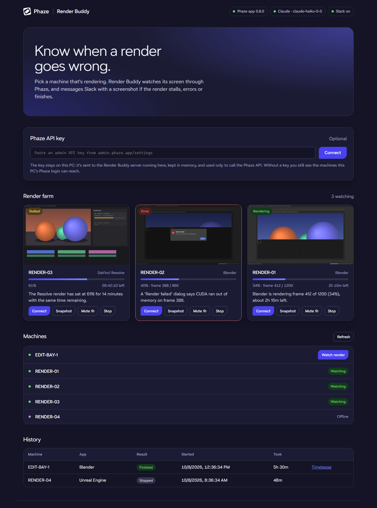
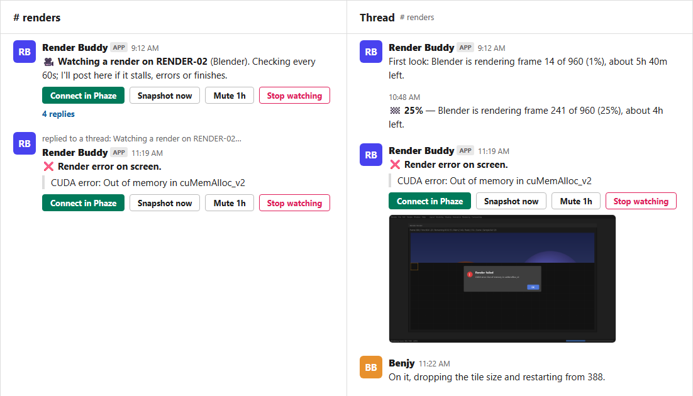
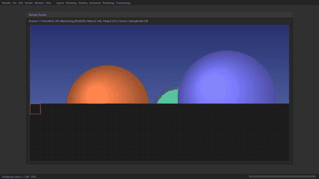

# Render Buddy: a Phaze API + MCP example

Render Buddy watches long renders on your Windows machines through [Phaze](https://phaze.app). It
sends a Slack message with a screenshot when a render stalls, hits an error, the app crashes, the
machine goes offline, or the render finishes. When a render finishes, you also get a timelapse GIF
of the whole run.

This was AI vibe coded with Opus 5.5, like the
[helpdesk example](https://github.com/boxerbk/phaze-mcp-api-helpdesk-example). It isn't a product.
It's here to show you (or your AI coding agent) a second real use of the Phaze API and MCP, small
enough to read in one sitting and copy.

> [!NOTE]
> Phaze currently only supports connections between *Windows computers*, and needs graphics
> acceleration (integrated or discrete GPU) on both ends.

- [What it does](#what-it-does)
- [How it works](#how-it-works)
- [Setup](#setup)
- [Running](#running)
- [How a render is judged](#how-a-render-is-judged)
- [Settings](#settings-env)
- [Files](#files)
- [Phaze in 60 seconds](#phaze-in-60-seconds)
- [Ideas to take it further](#ideas-to-take-it-further)
- [Troubleshooting](#troubleshooting)
- [Notes for AI coding agents](#notes-for-ai-coding-agents)

---

## What it does

1. Open the local web page. Optionally paste your Phaze API key. You see every machine you can
   reach.
2. Click **Watch render** on a machine and pick the renderer: Blender, After Effects or Media
   Encoder, Premiere, DaVinci Resolve, Cinema 4D or Redshift, Unreal Movie Render Queue, or
   auto-detect.
3. Render Buddy opens its own Phaze connection to that machine and takes a screenshot every
   minute. It never clicks or types.
4. Claude reads the render window: frame X of Y, percent, time remaining, and any error dialogs.
5. Slack gets one thread per render:
   - a first look
   - 25%, 50% and 75% milestones
   - alerts with a screenshot, broadcast to the channel
   - a timelapse GIF when it finishes
6. The **render farm** page shows a live thumbnail, progress bar, ETA and health badge for every
   watched machine, plus a history of past renders.





<sub>Both images were made with `python demo.py` (fake machines and renders). The Slack image is a mockup of what the bot posts.</sub>

When a render finishes, the thread gets a timelapse like this one:



Alerts in Slack have buttons:

| Button | What it does |
|---|---|
| **Connect in Phaze** | Opens a Phaze session to that machine (`phaze://connect?id=…`) |
| **Snapshot now** | Posts a fresh screenshot and status in the thread |
| **Mute 1h** | Stops alerts for an hour (Render Buddy still records them) |
| **Stop watching** | Ends the watch and closes Render Buddy's connection |

## How it works

The Phaze MCP server lives inside the Phaze app, listens on `127.0.0.1` only, and has no key. It
acts as whoever is signed in to the app. A website on the internet can't reach it. So Render Buddy
is a small local server that you run on a PC that has the Phaze app open, and the web page is
served by that server.

```
Browser (http://127.0.0.1:8765)
   │  fetch /api/...        (same origin; the browser never talks to Phaze directly)
   ▼
Render Buddy server (Python, same PC as the Phaze app)
   ├─ HTTPS + API key ─► public-api.phaze.app      org machines: names, owners, OS, online
   ├─ JSON-RPC ───────► 127.0.0.1:41010/mcp        list_hosts, connect, status, screenshot
   │                       └─ Phaze app ─► the render PC
   ├─ HTTPS ──────────► api.anthropic.com          "what does this screenshot show?"
   └─ Socket Mode ────► Slack                      thread per render, buttons
```

- **The machine list** joins the API and the MCP on machine ID, which is the same in both. The API
  says what exists in your org. The MCP's `phaze_list_hosts` says what *this PC's Phaze login* can
  actually reach. Only reachable machines get a **Watch render** button; the others are greyed
  out. Without an API key, the list comes from the MCP alone.
- **Your API key stays on your PC.** The page sends it to the local server, which keeps it in
  memory and uses it only to call the Phaze API. Alternatively, put it in `.env`.
- **The server only answers on `127.0.0.1`/`localhost`**, and rejects other `Host` headers to
  block DNS-rebinding tricks from other websites.

## Setup

You need:
- A Windows PC running the **Phaze app**, signed in, with the experimental **MCP server** feature
  on in client settings ([help](https://help.phaze.app/articles/6522930271-the-phaze-mcp-server)).
  Ideally it's signed in as a dedicated account that can reach your render machines.
- **Python 3.10+**.
- Optional but recommended: an **Anthropic API key** ([console.anthropic.com](https://console.anthropic.com)).
- Optional: a **Phaze API key** from an administrator at [admin.phaze.app/settings](https://admin.phaze.app/settings)
  ([help](https://help.phaze.app/articles/6515713992-the-phaze-api)).
- Optional: a **Slack workspace** where you can create an app.

**1. Install**

```bash
git clone https://github.com/boxerbk/render-buddy
cd render-buddy
python -m venv .venv && .venv\Scripts\activate
pip install -r requirements.txt
copy .env.example .env      # then fill in what you have
```

**2. Create the Slack app** (skip this to get notifications in the console instead) at
[api.slack.com/apps](https://api.slack.com/apps):

- **Socket Mode:** turn it on. Create an app-level token with `connections:write` and put it in
  `SLACK_APP_TOKEN`.
- **OAuth & Permissions → Bot token scopes:** `chat:write`, `files:write`. Put the bot token
  in `SLACK_BOT_TOKEN`.
- **Interactivity & Shortcuts:** turn it on. Socket Mode doesn't need a request URL.
- **Install** the app to your workspace, create a `#renders` channel, invite the bot, and put the
  channel **ID** (`C…`, shown in the channel details) in `SLACK_CHANNEL`.

**3. Check it offline**

```bash
pytest
```

The tests use a fake Phaze, fake Claude and fake Slack, and cover:
- stall detection
- error alerts
- milestones and the timelapse
- offline and lock-screen handling
- mute
- resuming after a restart
- the exact request sent to Claude

## Running

```bash
python run.py              # opens http://127.0.0.1:8765
python run.py --no-slack   # print notifications to the console instead of Slack
python run.py --no-browser --port 9000
```

To see the dashboard without Phaze, Claude or Slack, run `python demo.py`. It serves fake
machines and renders at http://127.0.0.1:8766.

Press Ctrl+C to stop. Render Buddy closes its Phaze connections. Renders that were still being
watched are picked up again the next time you start it, because jobs are stored in
`data/render_buddy.db`.

## How a render is judged

Asking Claude about every screenshot works, but it's wasteful. Render Buddy runs a free pixel diff on
every check (a 320×180 grayscale thumbnail) and asks Claude only when:

| Trigger | Why |
|---|---|
| The first check | Learn what app is on screen and how far along it is |
| A big change (more than 25% of pixels) | A dialog appeared, the app closed, or the render finished |
| No visible change for `STALL_MINUTES` | Is it really stuck, or just a slow frame? |
| Every `HEARTBEAT_MINUTES` | Keep the progress, ETA and milestones fresh |
| Someone clicks **Snapshot now** | They want a current answer |

Small changes, like a frame counter ticking, mean "still rendering", and that costs nothing. A
stall alert needs the screen frozen for `STALL_MINUTES` *and* two Claude stall verdicts in a row.
Only the diff can prove nothing is moving; Claude rules out the cases where a frozen screen is
fine.

Claude answers in a fixed JSON shape (structured outputs):

```json
{"app": "Blender", "state": "rendering", "progress_pct": 34, "frame": 412, "total_frames": 1200,
 "eta": "02:10:00", "error_text": null, "summary": "Blender is rendering frame 412 of 1200 (34%), about 2h left."}
```

`state` is one of `rendering`, `stalled`, `error_dialog`, `not_responding`, `app_closed`,
`finished`, `unknown`. Render Buddy adds two states of its own from Phaze:
- `offline`: the machine dropped off Phaze.
- `locked`: Windows is at the sign-in or lock screen, which Phaze can't capture.

The default model is `claude-haiku-5-5`. It reads render UIs well, and at one look every few
minutes it costs very little. Set `CLAUDE_MODEL` to use something else. **Without an Anthropic
key**, Render Buddy still works on the pixel diff alone. It can then only say that the screen stopped
changing, not why.

To add a renderer, add an entry to `profiles.py` with a short hint about where its progress shows
on screen.

## Settings (`.env`)

| Setting | Default | |
|---|---|---|
| `PHAZE_MCP_URL` | `http://127.0.0.1:41010/mcp` | The Phaze app's MCP |
| `PHAZE_API_KEY` | (none) | Optional; can be pasted into the page instead |
| `ANTHROPIC_API_KEY` | (none) | Optional; turns on Claude vision |
| `CLAUDE_MODEL` | `claude-haiku-5-5` | |
| `SLACK_BOT_TOKEN`, `SLACK_APP_TOKEN`, `SLACK_CHANNEL` | (none) | All three turn Slack on |
| `CHECK_INTERVAL_SEC` | `60` | Default screenshot interval (also set per watch on the page) |
| `STALL_MINUTES` | `10` | Default "unchanged this long = suspected stall" |
| `HEARTBEAT_MINUTES` | `15` | Ask Claude at least this often |
| `PORT` | `8765` | Web page port |
| `DATA_DIR` | `./data` | Database, latest screenshots, timelapse frames |

## Files

| File | What it is |
|---|---|
| `run.py` | Entry point: starts the web server, Slack and the watchers in one event loop |
| `server.py` | FastAPI: the web page and its JSON API, including the API + MCP machine merge |
| `watcher.py` | The watch loop: connect, screenshot, diff, ask Claude, decide, notify |
| `vision.py` | Pixel diff and the Claude call (image in, JSON out) |
| `profiles.py` | Per-renderer hints for Claude |
| `slack_bot.py` | Slack threads, uploads and buttons (Socket Mode) |
| `timelapse.py` | Saves a small frame per check and builds the GIF |
| `store.py` | SQLite: jobs and events |
| `phaze_api.py` | Tiny Phaze Enterprise API client (from the helpdesk example) |
| `phaze_mcp.py` | Tiny Phaze MCP client, with no mouse or keyboard methods on purpose |
| `web/` | The single-page dashboard, styled with Phaze's design tokens |
| `demo.py` | The dashboard with fake machines and renders (used for the images in `docs/`) |
| `tests/` | Offline tests |

---

## Phaze in 60 seconds

[Phaze](https://phaze.app) is a high-performance remote desktop. It has two developer surfaces:

```
 Phaze Enterprise API  (cloud, HTTPS, API key)          Phaze MCP server  (local, in the Phaze app)
 ─────────────────────────────────────────────          ─────────────────────────────────────────────
 "the control plane": who, what, where                  "the hands": see and operate a machine
 members, orgs, machines, groups, assignments,          list reachable machines, connect, screenshot,
 connection logs, relays, locations                     click, type, scroll, hand control to a guest
```

**API**
- Base URL `https://public-api.phaze.app/enterprise/v1`.
- Auth header `Authorization: Bearer <key>`.
- Lists are paginated with `limit` (up to 200) and `offset`.
- Full reference: [apidocs.phaze.app](https://apidocs.phaze.app).

**MCP**
- Plain JSON-RPC over HTTP at `http://127.0.0.1:41010/mcp`.
- Render Buddy uses `phaze_list_hosts`, `phaze_connect`, `phaze_status`, `phaze_screenshot` and
  `phaze_disconnect`.

Try it with curl:

```bash
curl -s -X POST http://127.0.0.1:41010/mcp \
  -H "Content-Type: application/json" -H "Accept: application/json, text/event-stream" \
  -d '{"jsonrpc":"2.0","id":1,"method":"tools/call","params":{"name":"phaze_list_hosts","arguments":{}}}'
```

`phaze_screenshot` returns an MCP `image` content block (base64 PNG); see `PhazeMCP.screenshot`.
For a longer tour of both surfaces, see the
[helpdesk example's README](https://github.com/boxerbk/phaze-mcp-api-helpdesk-example#part-1-the-phaze-enterprise-api).

## Ideas to take it further

- **One-click fixes.** Dismiss a crash dialog or press **Retry** from Slack. The MCP has click and
  type tools; this example leaves them out on purpose.
- **Morning digest:** "3 renders finished overnight, 1 failed at frame 812."
- **Auto-discovery.** Every hour, glance at idle machines and start watching any that show a render
  window.
- **Queue hand-off.** When a render finishes, connect and start the next item in the queue.
- **Cost per render.** Combine render time with machine specs from the API.

## Troubleshooting

| Symptom | Fix |
|---|---|
| "Phaze app not found" chip | Open the Phaze app, sign in, and turn on the MCP server in client settings |
| A machine is greyed out | This PC's Phaze login can't reach it. Sign in as an account that has access, or assign the machine to it |
| State stays **Locked screen** | The render PC is at the Windows sign-in or lock screen. Sign in on it (and consider disabling the lock screen on render nodes) |
| Everything shows **Rendering** but no progress | No `ANTHROPIC_API_KEY`: pixel-diff mode only knows if the screen is changing |
| Slack posts but buttons do nothing | Turn on Interactivity, and check that `SLACK_APP_TOKEN` (xapp-…) is set for Socket Mode |
| "Phaze rejected that API key" | Keys come from an administrator at [admin.phaze.app/settings](https://admin.phaze.app/settings) |

## Notes for AI coding agents

1. **Confirm access first:** call `phaze_status` through the MCP and `GET /orgs` with the API key.
2. **Never ask the user to paste keys into chat.** Keys go in `.env` or the local web page.
3. **Join API and MCP data on machine ID**, and treat `phaze_list_hosts` as the truth about what
   can be connected to from this PC.
4. **Connecting is asynchronous:** call `phaze_connect`, then poll `phaze_status` until
   `connected: true`, then take screenshots.
5. **Only close connections you opened** (`owner: "agent"`). Never close the user's own session.
6. The interesting logic is all in `watcher.py` (`Watcher.step`). Start there.

## License

[MIT](LICENSE)
